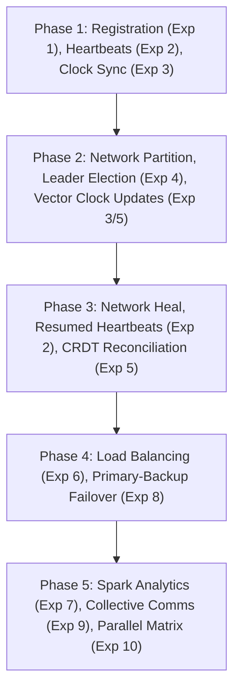

# Architecture

## 1. Folder layout

```
disaster-relief-web/
├── pom.xml
├── README.md
├── .github/pull_request_template.md
├── docs/ARCHITECTURE.md, docs/PROGRESS.md
├── legacy/                         original console experiments (read-only reference)
├── analytics-spark/                Exp 7 Spark module (Parth) — separate Maven module, launched as subprocess
├── data/                           H2 database files (git-ignored)
└── src/
    ├── main/java/com/drs/
    │   ├── DrsApplication.java
    │   ├── core/                   Prasham — Exp 1,2,3, partition, scenario runner, event bus
    │   │   ├── config/             SchedulingConfig
    │   │   ├── controller/         CoordinatorController
    │   │   ├── event/              EventPublisher, EventLog, EventLogRepository, EventController
    │   │   ├── model/              NodeStatus (JPA entity, Serializable), NodeStatusRepository
    │   │   ├── rmi/                NodeService (RMI contract; registry on 1099 comes later)
    │   │   └── service/            CoordinatorService
    │   ├── consensus/              Grasit — Exp 4 (Bully/Ring), Exp 5 (vector clock + CRDT)
    │   ├── faulttolerance/         Grasit — Exp 8 (primary-backup)
    │   ├── compute/                Parth  — Exp 6 (load balancing), Exp 7 (MapReduce/Spark client)
    │   └── comm/                   Vedant — Exp 9 (broadcast/scatter/gather), Exp 10 (parallel matrix)
    ├── main/resources/
    │   ├── application.properties
    │   └── static/                 index.html, css/app.css, js/api.js, js/events.js, js/layout.js (Vedant),
    │                               each person's own pages
    └── test/                       JUnit 5 + MockMvc; uses in-memory H2
```

## 2. Packages and owners

| Package | Owner | Experiments |
|---|---|---|
| `com.drs.core` | Prasham | 1 RMI registration, 2 heartbeats/thread pool, 3 Cristian + vector clocks, partition simulation, scenario runner, EventPublisher |
| `com.drs.consensus` | Grasit | 4 Bully/Ring election, 5 reconciliation + CRDT |
| `com.drs.faulttolerance` | Grasit | 8 primary-backup replication |
| `com.drs.compute` | Parth | 6 load balancing, 7 MapReduce/Spark |
| `com.drs.comm` | Vedant | 9 MPI-style collectives, 10 parallel matrix; frontend shell |

Never edit another person's package without telling them.

## 3. Conventions

* REST under `/api/...`, JSON only. Thin `@RestController`, logic in `@Service`.
* No `System.out` in services — return a result object with a `steps` list for the UI and call
  `EventPublisher.publish(module, type, payload)` for live events.
* Branch `feature/<name>-<topic>`, PR to `main`, 1 review.

## 4. Event bus

`EventPublisher.publish(String module, String type, Object payload)`:
1. serialises payload to JSON, 2. saves an `EventLog` row, 3. pushes to every SSE subscriber.

`GET /api/events` (SSE) sends **unnamed** events, so `new EventSource('/api/events').onmessage` receives all of them.
Each message `data` is:

```json
{"id": 12, "module": "coordinator", "type": "NODE_REGISTERED", "payload": "{...json string...}", "timestamp": "2026-10-25T07:00:00Z"}
```

`payload` is a JSON **string** — call `JSON.parse(msg.payload)` in the browser.

## 5. REST contract (agreed in the project plan — everyone follows this)

Status: **built** = exists on main, **temp** = Day 1 placeholder that Day 2 replaces, **planned** = owner implements it on the day shown in the plan.

### core (Prasham)

| Endpoint | Purpose | Status |
|---|---|---|
| `POST /api/nodes/register` | Exp1 register node, returns connectivity score | planned (Day 2) |
| `GET /api/nodes`, `GET /api/nodes/{id}` | List/get nodes with status ALIVE/SILENT | planned (Day 2) |
| `POST /api/nodes/{id}/heartbeat` | Exp2 heartbeat, handled by 4-thread pool | planned (Day 2) |
| `POST /api/simulator/start`, `/stop`, `/silence/{nodeId}` | Spawn simulated UAV/edge nodes | planned (Day 2) |
| `POST /api/clock/sync/{nodeId}`, `GET /api/clock/status` | Exp3 Cristian sync, vector clocks | planned (Day 3) |
| `POST /api/network/partition`, `/heal`, `GET /api/network/status` | Simulated partition | planned (Day 3) |
| `POST /api/scenario/run`, `GET /api/scenario/status`, `POST /api/scenario/reset` | Full story runner | planned (Day 4) |
| `GET /api/events` (SSE), `GET /api/events/history?limit=50` | Live events | **built** |

Temporary Day 1 endpoints (replaced by the `/api/nodes/...` ones on Day 2, do not build on these):

| Endpoint | Purpose | Status |
|---|---|---|
| `POST /api/coordinator/register` | Register node | temp |
| `GET /api/coordinator/nodes`, `/nodes/{id}`, `/nodes/{id}/state` | Read nodes | temp |
| `POST /api/coordinator/heartbeat/{nodeId}` | Heartbeat | temp |
| `GET /api/coordinator/time` | Cristian time server | temp |

### consensus + faulttolerance (Grasit)

| Endpoint | Purpose |
|---|---|
| `POST /api/election/bully`, `/ring`, `/compare`, `GET /api/election/history` | Exp4 |
| `POST /api/updates`, `GET /api/updates`, `DELETE /api/updates` | Exp5 stamped updates |
| `POST /api/reconcile`, `GET /api/reconcile/latest` | Exp5 merge |
| `POST /api/ft/updates`, `POST /api/ft/primary/fail`, `POST /api/ft/reset`, `GET /api/ft/state` | Exp8 |

### compute (Parth)

| Endpoint | Purpose |
|---|---|
| `POST /api/tasks`, `GET /api/tasks`, `POST /api/tasks/{id}/assign`, `DELETE /api/tasks` | Rescue tasks |
| `POST /api/loadbalancer/assign-all`, `GET /api/loadbalancer/nodes` | Exp6 |
| `POST /api/analytics/mapreduce/run`, `GET /api/analytics/mapreduce/latest`, `GET /api/analytics/mapreduce/history` | Exp7 |

### comm (Vedant)

| Endpoint | Purpose |
|---|---|
| `POST /api/comm/bcast`, `/scatter`, `/gather`, `/run-all` | Exp9 |
| `POST /api/matrix/run`, `POST /api/matrix/sweep` | Exp10 |

## 6. Event types

Format on `/api/events`: unnamed SSE messages, so `new EventSource('/api/events').onmessage` gets all of them.
Each message `data` is:

```json
{"id": 12, "module": "core", "type": "NODE_REGISTERED", "payload": "{...json string...}", "timestamp": "2026-10-25T07:00:00Z"}
```

`payload` is a JSON **string**: call `JSON.parse(msg.payload)` in the browser.

| Module | Types |
|---|---|
| `core` | NODE_REGISTERED, HEARTBEAT, NODE_SILENT, CLOCK_SYNCED, NETWORK_PARTITIONED, NETWORK_HEALED, SCENARIO_PHASE |
| `consensus` | ELECTION_STARTED, LEADER_ELECTED, RECONCILED |
| `ft` | FT_REPLICATED, FT_PRIMARY_FAILED, FT_BACKUP_PROMOTED |
| `compute` | TASK_CREATED, TASK_ASSIGNED, ANALYTICS_STARTED, ANALYTICS_DONE |
| `comm` | COMM_BCAST, COMM_SCATTER, COMM_GATHER, MATRIX_DONE |

Day 1 temporary names (replaced on Day 2, do not listen for these): module `coordinator` / `heartbeat` with types `NODE_REGISTERED`, `HEARTBEAT_RECEIVED`, `PARTITION_SUSPECTED`.

Owners may add new types in their own module; add a row here in the same PR.

## 7. Connectivity score (Exp 1, unchanged from legacy)

`score = 2 × signal + battery` → `>=150 STABLE`, `>=100 AT_RISK`, `>=50 PARTITION_LIKELY`, else `PARTITIONED`.
Silence threshold 6000 ms, monitor every 1 s, worker pool 4 threads.

## 8. DTOs — consensus + faulttolerance (Grasit)

All DTOs live in `com.drs.consensus.model` and `com.drs.faulttolerance.model`.
Jackson serialises them to JSON automatically via getters.

### `ElectionNode` (request input)

```json
{ "id": "UAV-01", "priority": 1, "alive": true }
```

### `ElectionResult` (response from `POST /api/election/bully`, `/ring`, `/compare`)

```json
{
  "algorithm": "BULLY",
  "leaderId": "Edge-01",
  "leaderPriority": 3,
  "totalMessages": 8,
  "steps": [
    "[Bully] UAV-01 notices the coordinator is unreachable -> starts an election.",
    "[Bully] UAV-01 --ELECTION--> UAV-02",
    "..."
  ]
}
```

`/compare` returns both Bully and Ring results:

```json
{
  "bully": { /* ElectionResult */ },
  "ring":  { /* ElectionResult */ }
}
```

### `UpdateRecord` (request body for `POST /api/updates`)

```json
{
  "recordId": "REC-1",
  "resourceKey": "House-12",
  "resourceType": "STATUS",
  "value": "RESCUED",
  "clusterId": "Cluster-A",
  "nodeId": "UAV-01",
  "description": "UAV-01 marks House-12 rescued",
  "vector": { "UAV-01": 2, "UAV-02": 0, "Edge-01": 0 }
}
```

### `Resolution` (part of reconciliation response)

```json
{
  "resourceKey": "House-12",
  "resourceType": "STATUS",
  "finalValue": "NEEDS_RESCUE",
  "method": "POLICY_RESOLVED",
  "needsHumanReview": true,
  "contributingUpdates": [ { "recordId": "REC-1", "value": "RESCUED", "vector": {...} }, ... ],
  "explanation": "2 concurrent, conflicting updates were found. Safety-first policy applied..."
}
```

### `ReconciliationResult` (response from `POST /api/reconcile`)

```json
{
  "resolutions": [ /* Resolution[] */ ],
  "steps": [ "Starting reconciliation of 4 updates.", "..." ],
  "totalUpdates": 4,
  "conflictsDetected": 1,
  "humanReviewRequired": 1
}
```

### `SystemUpdate` (used in fault-tolerance, Exp 8)

```json
{
  "updateId": "UPDATE-1",
  "resourceId": "House-12",
  "updateType": "STATUS",
  "value": "NEEDS_RESCUE",
  "sourceNode": "UAV-01",
  "timestamp": 1729877160000
}
```

### `FaultToleranceResult` (response from all `/api/ft/*` endpoints)

```json
{
  "primaryId": "Coordinator-Primary",
  "backupId": "Coordinator-Backup",
  "primaryActive": false,
  "backupPromoted": true,
  "currentState": {
    "House-12": { /* SystemUpdate */ },
    "Hospital-01": { /* SystemUpdate */ }
  },
  "steps": [
    "[Coordinator-Primary] Processing system update: UPDATE-1 | ...",
    "[Coordinator-Primary] Update successfully replicated.",
    "..."
  ]
}
```

## 9. DTOs & Schemas — compute + analytics-spark (Parth)

All compute DTOs live in `com.drs.compute.model`.

### `AssignmentResult` (load balancer task assignment output)

```json
{
  "taskId": "TASK-01",
  "taskDescription": "Search for survivors",
  "workload": 3.0,
  "success": true,
  "chosenNodeId": "Edge-01",
  "updatedLoad": 3.0,
  "effectiveCapacity": 13.13,
  "finalUtilization": 0.23,
  "evaluations": [
    {
      "nodeId": "UAV-01",
      "currentLoad": 0.0,
      "projectedUtilization": 0.40,
      "skipped": false,
      "skippedReason": null,
      "effectiveCapacity": 7.50
    },
    {
      "nodeId": "Edge-01",
      "currentLoad": 0.0,
      "projectedUtilization": 0.23,
      "skipped": false,
      "skippedReason": null,
      "effectiveCapacity": 13.13
    }
  ],
  "steps": [
    "Assigning Task: TASK-01",
    "Description: Search for survivors",
    "Required Workload: 3.0",
    "UAV-01 | Current Load = 0.00 | Projected Utilization = 0.40",
    "Edge-01 | Current Load = 0.00 | Projected Utilization = 0.23",
    "TASK ASSIGNED SUCCESSFULLY",
    "Task TASK-01 assigned to Edge-01",
    "Updated Load = 3.00"
  ]
}
```

### `analytics_result.json` (output from `analytics-spark` standalone MapReduce)

```json
{
  "appName": "DRS-SparkAnalytics",
  "timestamp": "2026-10-26T23:30:00Z",
  "inputFile": "input/rescue_tasks.txt",
  "totalTasks": 10,
  "totalWorkload": 41.0,
  "countsPerCluster": {
    "ClusterA": 4,
    "ClusterB": 3,
    "ClusterC": 3
  },
  "workloadPerCluster": {
    "ClusterA": 14.0,
    "ClusterB": 15.0,
    "ClusterC": 12.0
  },
  "countsPerType": {
    "Food": 3,
    "Medical": 4,
    "Search": 3
  },
  "workloadPerType": {
    "Food": 10.0,
    "Medical": 14.0,
    "Search": 17.0
  },
  "breakdown": [
    { "cluster": "ClusterA", "taskType": "Food", "taskCount": 1, "totalWorkload": 3.0 },
    { "cluster": "ClusterA", "taskType": "Medical", "taskCount": 2, "totalWorkload": 7.0 }
  ]
}
```


## 10. DTOs & Schemas — core Exp 3 (Clock Sync & Network Partition)

All core Exp 3 DTOs live in `com.drs.core.service` and are served by `ClockController` and `NetworkController`.

### `NodeClockSyncResult` (response from `POST /api/clock/sync/{nodeId}`)

```json
{
  "nodeId": "UAV-01",
  "clusterId": "Cluster-A",
  "success": true,
  "injectedSkewMillis": 1500,
  "t0": 1729877000100,
  "serverTime": 1729877000125,
  "t2": 1729877000150,
  "rttMillis": 50,
  "offsetMillis": -1475,
  "rawLocalTime": 1729877001600,
  "correctedTime": 1729877000125,
  "lastSyncTime": "2026-10-29T10:30:00Z",
  "errorMessage": null,
  "steps": [
    "[Cristian] Initiating clock sync for node UAV-01 (Cluster-A)",
    "[Cristian] t0 (local node time before request) = 1729877000100 ms (skew = 1500 ms)",
    "[Cristian] t1 (coordinator server time) = 1729877000125 ms",
    "[Cristian] t2 (local node time on receipt) = 1729877000150 ms",
    "[Cristian] RTT = (t2 - t0) = 50 ms (estimated one-way delay ~ 25 ms)",
    "[Cristian] Clock Offset = t1 + RTT/2 - t2 = -1475 ms",
    "[Cristian] Corrected Clock Time = 1729877000125 ms"
  ]
}
```

### `NetworkStatus` (response from `POST /api/network/partition`, `/heal`, `GET /api/network/status`)

```json
{
  "partitioned": true,
  "clusters": ["Cluster-A", "Cluster-B"],
  "nodeClusters": {
    "Edge-01": "Cluster-B",
    "UAV-01": "Cluster-A",
    "UAV-02": "Cluster-A"
  },
  "coordinatorReachable": false,
  "message": "Network partitioned: Cluster-A and Cluster-B are isolated. Coordinator unreachable.",
  "steps": [
    "[NETWORK] Partition triggered: wireless link between clusters severed",
    "[NETWORK] Cluster-A (UAV nodes) and Cluster-B (Edge nodes) are isolated",
    "[NETWORK] Coordinator is UNREACHABLE for all edge nodes",
    "[NETWORK] Local leader election (Exp 4) and partitioned logging (Exp 3/5) required"
  ]
}
```

---

## 11. Day 4 ScenarioRunner Inter-Service Contracts (Agreed Specification)

To orchestrate the full disaster story end-to-end on Day 4, each package agrees to expose the following service methods. Prasham's `ScenarioRunner` (`com.drs.core.scenario`) will invoke them in sequence:

### 1. Consensus & Fault Tolerance Contracts (Grasit — `com.drs.consensus`, `com.drs.faulttolerance`)

* **`ElectionService.runBothElections(String clusterId)`**
  * *Signature:* `ElectionComparisonResult runBothElections(String clusterId)`
  * *Purpose:* When network partitions in Phase 2, runs both Bully and Ring algorithms for the given cluster and returns leader + message counts for side-by-side UI comparison.
* **`LeaderProvider.currentLeader(String clusterId)`**
  * *Signature:* `String currentLeader(String clusterId)`
  * *Purpose:* Returns the active elected leader nodeId for a cluster (e.g. `UAV-02` for Cluster-A, `Edge-01` for Cluster-B).
* **`UpdateService.applyLocalUpdate(String resourceKey, String resourceType, String value, String description, String clusterId, String nodeId, String sendTo)`**
  * *Signature:* `UpdateRecord applyLocalUpdate(String resourceKey, String resourceType, String value, String description, String clusterId, String nodeId, String sendTo)`
  * *Purpose:* Ticks the node's vector clock, appends an `UpdateRecord` tagged with the new clock snapshot to the pending partition log, and forwards it across the local cluster bus if `sendTo != null`.
* **`ReconciliationService.reconcileAll()`**
  * *Signature:* `ReconciliationResult reconcileAll()`
  * *Purpose:* When the partition heals in Phase 3, reconciles all updates across clusters using safety-first conflict resolution (`NEEDS_RESCUE` beats `RESCUED`) and CRDT set union for survivors.
* **`FaultToleranceService.simulatePrimaryFailure()`**
  * *Signature:* `FaultToleranceResult simulatePrimaryFailure()`
  * *Purpose:* Triggers Exp 8 coordinator failover to promote the backup replica to primary.

### 2. Compute Contracts (Parth — `com.drs.compute`)

* **`LoadBalancerService.balanceAll()`**
  * *Signature:* `List<AssignmentResult> balanceAll()`
  * *Purpose:* Assigns pending rescue tasks to available nodes based on effective capacity (`battery × signal × baseCapacity`).
* **`SparkAnalyticsService.runTaskAnalytics()`**
  * *Signature:* `AnalyticsResult runTaskAnalytics()`
  * *Purpose:* Executes the Exp 7 MapReduce / Spark subprocess on rescue task workload data.

### 3. Collective Communication & Matrix Contracts (Vedant — `com.drs.comm`)

* **`CommunicatorService.runCollectiveAlert(List<Integer> alertData)`**
  * *Signature:* `CollectiveCommResult runCollectiveAlert(List<Integer> alertData)`
  * *Purpose:* Broadcasts emergency alerts to all ranks (Bcast), scatters rescue supplies (Scatter), and gathers team reports (Gather).
* **`MatrixService.runBenchmark(int matrixSize)`**
  * *Signature:* `MatrixBenchmarkResult runBenchmark(int matrixSize)`
  * *Purpose:* Executes parallel block matrix multiplication benchmark across available worker threads.

### 4. Story Execution Phases (Day 4 Scenario Pipeline)



